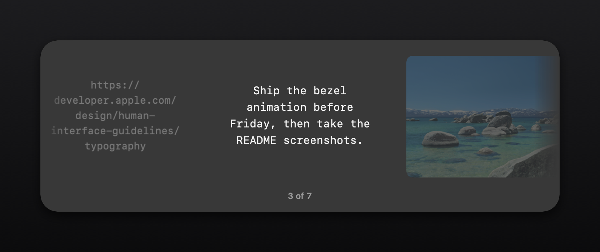
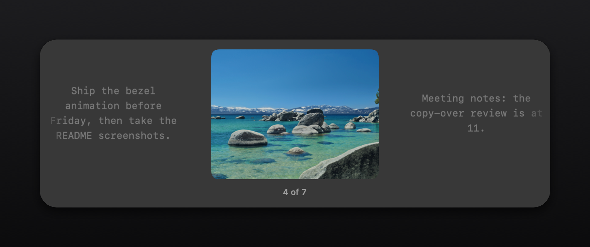

# CopyOver

A macOS menu-bar clipboard history with text, images and files, opened by a
Jumpcut-style sticky bezel.

Hotkey: Command + Option + Control + V. Change it in Preferences.

## Screenshots

## Build

    ./build.sh          # builds CopyOver.app in ./dist
    open dist/CopyOver.app

Requires macOS 14 or newer and the Command Line Tools (a Swift toolchain).

The build uses Swift Package Manager and ad-hoc signing. Xcode and third-party
dependencies are not required. Run the script from any directory. The app stays
in the menu bar and does not appear in the Dock.

## Use

- Copy text, an image, or one or more files in Finder.
- Press Command + Option + Control + V to open history on the active screen.
- Press V, Right, or Down to move to an older item. Shift + V, Shift + Right,
  Left, or Up moves back. The shortcut also cycles while the bezel is open.
  Stepping past the newest or oldest item moves to the other end without the
  long slide back.
- Press Return to copy the selected item and paste into the app you were using.
  The bezel reopens on that item, so you can walk through history in order.
- Press Escape to dismiss. Releasing the shortcut modifiers leaves the bezel open.
- Click the menu-bar icon for the 20 most recent items, Clear history,
  Preferences, and Quit. Preferences records a new shortcut when you click the
  field and press a combination. Escape cancels. If another app owns the
  combination, the old shortcut is kept and a message appears.

Pasting needs Accessibility access. The first Return asks for it with the
system dialog; until it is granted the bezel says it copied and cannot paste
yet, and the item is on the clipboard for Command + V. The menu-bar item Allow
Pasting in Accessibility opens System Settings > Privacy & Security >
Accessibility at any time. The app is ad-hoc signed, so a rebuilt app is not
trusted even while an older CopyOver row shows as switched on: remove that row
with the minus button and add the new app. To keep the grant across builds,
create a code-signing certificate named CopyOver in Keychain Access
(Certificate Assistant > Create a Certificate, type Code Signing); build.sh
signs with it when it exists. Every paste attempt is logged to
`~/Library/Application Support/CopyOver/paste.log`. If another clipboard app owns the shortcut, quit it
and relaunch CopyOver, or record a different shortcut in Preferences.

## Storage

History is local in `~/Library/Application Support/CopyOver/`. `history.json`
holds text and file references. Images are stored beside it as PNG files. Files
are referenced in their original locations, not duplicated; moving or deleting
an original file can make that history entry unusable.

CopyOver keeps 200 items, moves duplicates to the top, and limits image storage
to 500 MiB by evicting the oldest images. It skips empty text, text over 2 MiB,
images over 40 MiB, and clipboard items marked `org.nspasteboard.ConcealedType`.
Clear history deletes the stored entries and images. It does not erase the
current system clipboard or the original files.

## Verify

    ./scripts/swift-package.sh test -c release
    ./build.sh
    codesign --verify --strict dist/CopyOver.app
    open dist/CopyOver.app

The tests use temporary storage and named pasteboards. They exercise limits,
eviction, duplicates, persistence, concealed items, all three clipboard types,
and selection wrapping. Live checks should also cover the sticky hotkey,
Return into TextEdit, Escape, Finder copies, and quitting and relaunching.

The package wrapper handles a Command Line Tools installation that contains both
the old and new `SwiftBridging` module maps. It creates a compiler overlay under
`.build/` to hide the duplicate for this build only. It does not modify the SDK
or installed tools. On an unaffected installation, it calls Swift Package
Manager without the overlay.
