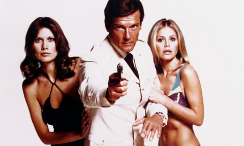
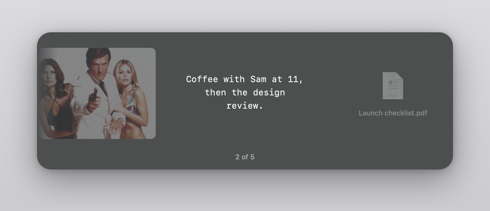
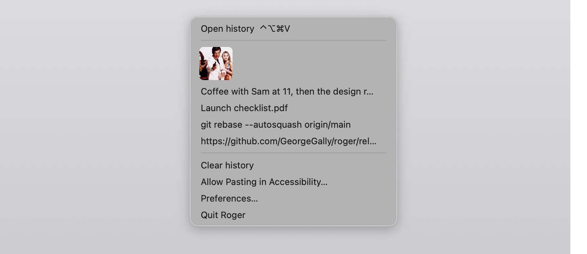
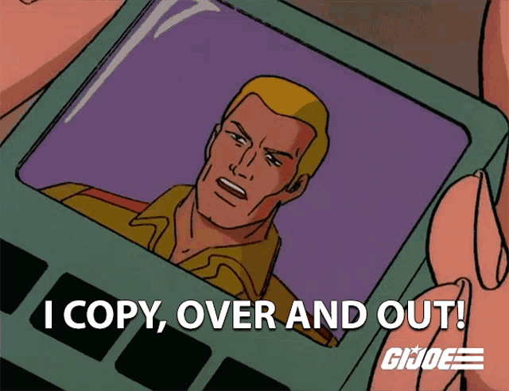

# Roger

A clipboard history for macOS: every text, image and file you copy, one
keystroke away in the menu bar.

## Download

Download `Roger.app` from the [Releases page](https://github.com/GeorgeGally/roger/releases).

## Install

1. Drag `Roger.app` into Applications.
2. Open it. Roger lives in the menu bar and does not appear in the Dock.
3. When macOS asks for Accessibility, turn it on. Roger needs it to paste for
   you; until then Return only copies.

Roger is not notarized: there is no Apple Developer ID behind it. On macOS 15
and later the first launch is blocked. Open System Settings > Privacy &
Security, scroll to the notice about Roger, and click Open Anyway. After that
the app opens normally. If the button does not appear, clear the quarantine
flag from Terminal and open the app again:

    xattr -dr com.apple.quarantine /Applications/Roger.app

## Use

Command + Option + Control + V opens the history on the screen you are on.
Change it in Preferences.

- Press V, Right, or Down to move to an older item. Shift + V, Left, or Up
  moves back.
- Press Return to copy the selected item and paste it into the app you were
  using. Escape dismisses.
- Click the menu-bar icon for the 20 most recent items, Clear history,
  Preferences, and Quit.

## License

[MIT](LICENSE).
